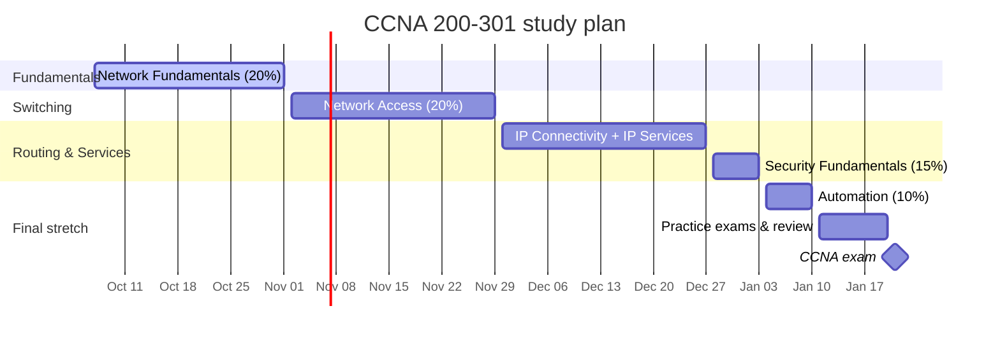

<div align="center">

# 🌐 CCNA Journey

### From zero to Cisco Certified Network Associate — documented day by day


</div>

---

## 👋 About this repo

This is my public study journal for the **Cisco CCNA 200-301** exam.

Instead of just collecting a certificate, I'm documenting **every topic, every lab and every mistake** — so anyone can follow the process, and so I can prove I actually understand the material.

After the CCNA, this repo grows into a **hands-on home lab and cybersecurity journey**: a segmented network with VLANs, firewall rules, internal services and security monitoring.

---

## 📈 Progress

```
Network Fundamentals      ██░░░░░░░░░░░░░░░░░░   2 / 14
Network Access            ░░░░░░░░░░░░░░░░░░░░   0 / 9
IP Connectivity           ░░░░░░░░░░░░░░░░░░░░   0 / 5
IP Services               ░░░░░░░░░░░░░░░░░░░░   0 / 9
Security Fundamentals     ░░░░░░░░░░░░░░░░░░░░   0 / 10
Automation                ░░░░░░░░░░░░░░░░░░░░   0 / 7
```

**Starting point (self-assessment, day 1):** 0 🟢 confident · 13 🟡 rusty · 40 🔴 new

👉 Full checklist with every exam topic: **[CCNA-BLUEPRINT.md](CCNA-BLUEPRINT.md)**

---

## 🗓️ Timeline



👉 Week-by-week plan: **[ROADMAP.md](ROADMAP.md)**

---

## 📚 Study notes

| # | Topic | Quiz |
|---|---|---|
| 0.1 | [OSI & TCP/IP models](network/00-osi-tcpip.md) | 8/8 |
| 1.1 | [Network components](network/01-network-components.md) | 7/8 |

👉 Daily log with what I studied and what went wrong: **[STUDY-LOG.md](STUDY-LOG.md)**

---

## 🧠 How I study

```
📖 Learn the topic  →  ❓ Quiz (exam-style, in English)  →  🧪 Lab in Packet Tracer  →  📝 Write a note  →  🔁 Review 2 weeks later
```

Every note answers the same questions ([template](documentation/TEMPLATE.md)):
**What is it? · How does it work? · Why does it matter? · How did I configure it? · What went wrong? · How did I fix it?**

The *"What went wrong?"* part is on purpose — mistakes are where the real learning happens.

---

## 🗂️ Repository structure

```
ccna-journey/
├── README.md              ← you are here
├── ROADMAP.md             ← week-by-week plan
├── CCNA-BLUEPRINT.md      ← every exam topic + progress
├── STUDY-LOG.md           ← daily journal
├── network/               ← study notes (one per topic)
├── packet-tracer/         ← lab files (.pkt)
├── diagrams/              ← topology diagrams
├── screenshots/           ← proof of configs & tests
├── documentation/         ← note template
├── linux/                 ← after the exam
└── cybersecurity/         ← after the exam
```

---

## 🛠️ Tools & resources

| | |
|---|---|
| 🧪 **Labs** | Cisco Packet Tracer |
| 📖 **Reading** | *CCNA 200-301 Official Cert Guide* (Wendell Odom), study-ccna.com |
| 🎥 **When stuck** | Jeremy's IT Lab |
| 🔁 **Memory** | Anki flashcards |
| 📝 **Practice exams** | Boson ExSim-Max (January) |

---

## 🚀 After the CCNA

- 🖥️ Physical lab: managed switch + mini PC with OPNsense
- 🔀 Segmented network: HOME · SERVERS · IoT · GUEST · MANAGEMENT VLANs
- 🔐 Firewall rules and access matrix between segments
- 🐧 Linux + OverTheWire Bandit
- 🌐 Web security with PortSwigger Web Security Academy
- 🎯 TryHackMe / Hack The Box

---

<div align="center">

⭐ *If you're also studying for the CCNA, feel free to follow along!*

</div>
